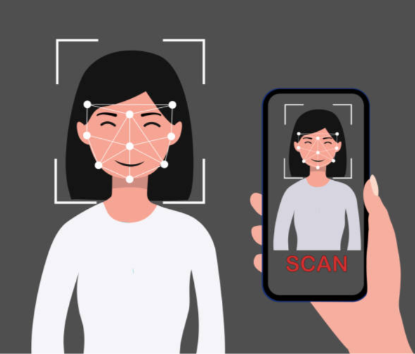

- take part in the experience
- 
- - 
- fille /garçon
- ville
- nom d'aéroport
- prenom
- photo
- tes passions
- tes rêves
- ton caractère
- ton style ton parcours de vie
- saurais tu devenir ton futur toi meme ou aurais tu besoin d'une boule de cyrstal ?
- :iphone: :standing_woman: :iphone: :standing_man:
- - :iphone: :standing_woman: :iphone: :standing_man:
- hey
- poster photo et un iphone au dessus (un dessin de css) pour fiare comme si je suis qui ? la photo est numerique

- Display a digital photo of a person as a poster

- CSS-drawn iPhone overlay around the photo for unique visual appeal

- quelqu'un a un job, est voyageur ou musicein u sportif,

poster photo et un iphone au dessus (un dessin de css) pour fiare comme si je suis qui ? la photo est numerique

Display a digital photo of a person as a poster

CSS-drawn iPhone overlay around the photo for unique visual appeal

quelqu'un a un job, est voyageur ou musicein u sportif,

For users to access their "digital ID", they use a digital method (presumably, you mean digital authentication or interaction).
- take part in the experience
- ton identite numerique  🔮 . Elle ne révèle PAS ton destin, ta personnalité ou ton histoire intime

Contrairement à une identité numérique créative (comme celle que tu explores sur GitHub), elle ne dit rien sur :

• tes passions
• tes rêves
• ton caractère
• ton style
• ton parcours de vie
• ton futur

Elle est froide, neutre, fonctionnelle

